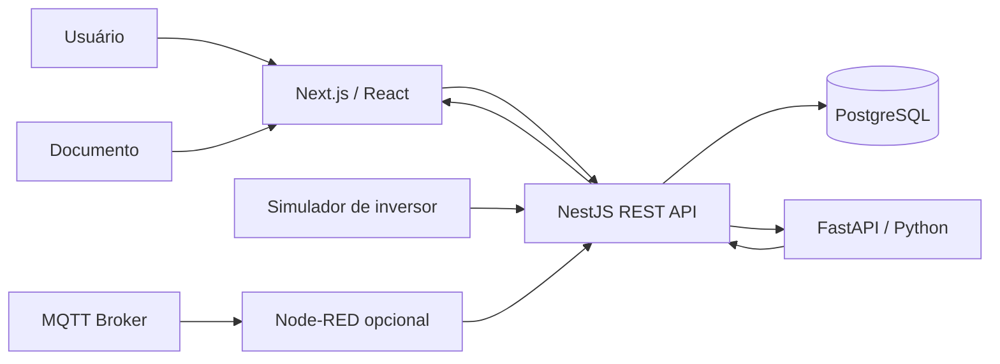

# Arquitetura

## Contexto

O case usa quatro domínios que compartilham contratos e persistência, mas permanecem separados por responsabilidade:

- **Document Intelligence**: especificações técnicas e extração estruturada;
- **Engineering Drawing**: geração e aprovação de desenho;
- **Market Intelligence**: indicadores e análise de dados não estruturados;
- **Industrial IoT/HMI**: telemetria e monitoramento.

## Componentes

## Decisões

1. **NestJS como API principal**: demonstra a stack exigida na vaga de desenhos.
2. **Python separado**: mantém ciência de dados/IA desacoplada do backend transacional.
3. **PostgreSQL**: atende SQL e facilita auditoria de revisões.
4. **Next.js**: centraliza telas de revisão, indicadores e HMI.
5. **MQTT**: representa integração IoT sem depender de equipamento real.
6. **Dados sintéticos**: evita uso de documentos ou dados proprietários.
